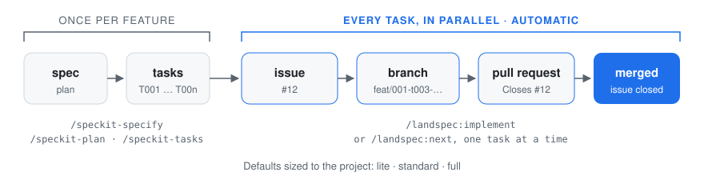

<h1 align="center">jit-speckit</h1>

<p align="center">
  <em>Spec Kit, with the boring parts done.<br>
  Every task gets an issue, a branch and a pull request. Every commit gets checked. Every project starts with the right defaults.</em>
</p>

<p align="center">
  <a href="https://github.com/iamalisson/jit-speckit/actions/workflows/test.yml"></a>
  
  
  
</p>

<p align="center">
  <picture>
    <source media="(prefers-color-scheme: dark)" srcset="assets/flow-dark.svg">
    
  </picture>
</p>

---

[GitHub Spec Kit](https://github.com/github/spec-kit) turns a feature idea into a spec, a plan and a
task list, and Claude writes the code. jit-speckit plugs into it and handles everything around
that code:

- every task gets a GitHub issue, its own branch and its own pull request;
- secrets are refused at commit and push, and every pull request passes a security gate;
- the project's constitution starts with security, testing and simplicity defaults, sized to how
  serious the project is.

You plan the feature and review the work. Claude writes the code, and jit-speckit does the rest
the same way every time.

## Install

In Claude Code:

```
/plugin install jit-speckit --marketplace iamalisson/jit-speckit
```

<sub>Needs Claude Code 2.1.295 or newer: from that version the command guard blocks a command when it times out or crashes.</sub>

You also need `git` and the [GitHub CLI](https://cli.github.com), logged in. `/jit-speckit:init`
installs spec-kit for you if it's missing.

## Update

```
claude plugin marketplace update jit-speckit && claude plugin update jit-speckit@jit-speckit
```

Then `/reload-plugins`, and **`/jit-speckit:init` once in every project that already uses it**:
each project keeps its own copy of the extension under `.specify/`, and only `init` refreshes it
(it keeps the level). Details: [docs/reference.md](docs/reference.md#update).

## Start

| Your project | Run | Then |
|---|---|---|
| **New** (empty folder) | `/jit-speckit:new` | the foundation spec it suggests: you pick the stack together with Claude, and it sets up the project (tooling, CI, containers) and jit-speckit. To set up only jit-speckit and describe the project yourself, run `/jit-speckit:init`, then `/speckit-constitution` |
| **Existing** (has code, no spec-kit yet) | `/jit-speckit:init` | nothing: it reads your code and fills the constitution for you |

`init` asks one question: how serious the project is (**lite**, **standard** or **full**, see
[Levels](#levels)). It changes nothing in your code and commits nothing; you review the setup and
commit it. What `new` asks and sets up: [docs/reference.md](docs/reference.md#what-new-does).

## The loop

| How often | Run | What you get |
|---|---|---|
| **Once per feature** | `/speckit-specify "what and why"` | the spec |
| | *(optional)* `/speckit-clarify` | fewer open questions, before planning |
| | `/speckit-plan` | the technical plan |
| | `/speckit-tasks` | the task list, grounded in the real code, **one issue per task**, and a spec PR |
| | *(optional)* `/speckit-analyze` | a consistency check (required on `full`) |
| | merge the spec PR | |
| **Once per task** | `/jit-speckit:next` | progress, then the next open task: **its branch → code → checks (tests, mutants) → review → PR**. Several features? `next 002` |
| | merge the PR | the issue closes |
| **When every task is done** | `/speckit-converge` | compares the code with the spec; anything unbuilt becomes new tasks with issues |

**Small fixes don't need the feature loop.** A typo, a one-line bug fix or a dependency bump
goes on a normal branch with a normal PR. The hooks and the CI gate still apply. The spec, issue
and per-task flow are for features.

The spec PR and the task PRs are separate on purpose: task branches start from the base branch
and need `tasks.md` there, and each task PR stays small and closes one issue. See
**[examples/](examples/)** for one feature walked through from spec to merged PRs, with the
real issue and PR bodies.

When `/jit-speckit:next` says every task is done, run `/speckit-converge`. If it finds nothing
left to build, the feature is finished: run `/jit-speckit:security` before you release it.

> `/jit-speckit:next` picks the next task for you. `/speckit-implement T007` does the same for a
> specific task. Either way, exactly one task per run.

Why one task = one issue = one branch = one PR, with the evidence: [docs/design.md](docs/design.md).

## Security, built in

| When | Check |
|---|---|
| **every commit** | refuses `.env`, keys and credential files, and tokens or passwords in the code. Under a second. |
| **every command Claude runs** | blocks `--no-verify`, `git add -A`, commits on base branches and pushes to them |
| **every push** | re-checks every outgoing commit, including ones made with `--no-verify` |
| **before each PR** | an **independent review** by a fresh agent (`jit-speckit:reviewer`, on Opus unless `review_model:` says `sonnet` or `fable`) that reads the whole repository, not the diff (siblings' guards, claims re-run, one mutation, the real upgrade path), scanners on the changed files (the PR is refused until they ran on its exact diff), `/security-review`; then GitHub Copilot code review is asked for on the PR, and the output says whether GitHub added it |
| **every PR, and weekly** | CI gate (standard and full): Gitleaks, OSV-Scanner and zizmor (Semgrep with the OWASP rules on `full`, from its image pinned by digest, its rules fetched from the Semgrep registry at run time; trivy on Dockerfiles and Terraform when the project has them), all pinned and checksum-verified |
| **before a release** | `/jit-speckit:security`, the full audit |

Why each layer exists, and what it can't do: **[docs/security.md](docs/security.md)**.

## Levels

Pick one at `init`, and change it any time with `/jit-speckit:level`. Going down never deletes
files.

| | **lite** | **standard** (default) | **full** |
|---|---|---|---|
| For | prototypes, solo work | products, small teams | production, money, personal data |
| Branches | `feat/*` → `main` | `feat/*` → `develop` → `main` | `feat/*` → `develop` → `staging` → `main` |
| Constitution defaults | KISS, secrets, tests for logic, task = issue = PR | + security baseline, stack idioms, dependency policy, integration tests | + threat model per feature, data integrity, observability, releases |
| Added to the repo | git hooks, PR template, `.claude/settings.json` without AI attribution (only when the project has none yet) | + CI for your stack, security CI, Dependabot | + Semgrep in CI, CODEOWNERS, SECURITY.md, release workflow |
| Before each PR | asks first, then the independent review, recorded and required | the independent review, recorded and required | the same, and evidence is required |
| `/speckit-analyze` | optional | optional | required before any task: its report is recorded, and a changed `tasks.md` needs a new one |

Your stack is detected and shapes the CI and the constitution; your files are never overwritten.
Details, the configuration keys and what runs automatically: [docs/reference.md](docs/reference.md).

## Help

`/jit-speckit:help` shows every command, level and setting. Ask it anything:
`/jit-speckit:help why is the spec a separate PR?`

## Uninstall

`/jit-speckit:remove` takes jit-speckit out of one project (`--with-speckit` also removes
spec-kit's files, your constitution included); `/plugin uninstall jit-speckit` removes the plugin from Claude Code. What
`remove` deletes and keeps: [docs/reference.md](docs/reference.md#uninstall).

## More

- [docs/design.md](docs/design.md): why it works this way (one task = one PR, the spec PR, the independent review, levels)
- [docs/reference.md](docs/reference.md): what runs automatically, configuration, Claude Code tools, `new`, update and uninstall details
- [docs/security.md](docs/security.md): every security layer and its limits
- [examples/](examples/): one feature from spec to merged PRs, with the real issue and PR bodies
- [docs/GUIDELINES.md](docs/GUIDELINES.md), [docs/GUARDRAILS.md](docs/GUARDRAILS.md), [docs/references.yaml](docs/references.yaml): how `new` and the reviews decide
